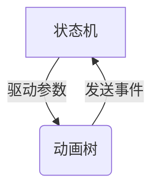

## 蒙皮动画技术

蒙皮动画(Skinning Animation)是3D计算机图形学中实现角色动画的核心技术，通过将模型表面(皮肤)与骨骼系统绑定，实现自然的变形效果。

### 技术原理

1. **骨骼层次结构**：骨骼以树状结构组织，父子关系决定变形传递
2. **顶点绑定**：每个顶点可绑定到多个骨骼，并分配权重
3. **矩阵调色板**：存储骨骼变换矩阵供GPU使用

### 实现代码示例

```cpp
// 骨骼变换计算
for (Bone& bone : skeleton.bones) {
    bone.globalTransform = parentTransform * bone.localTransform;
    bone.finalTransform = bone.globalTransform * bone.offsetMatrix;
}

// 顶点着色器中的蒙皮计算
vec4 skinnedPosition = vec4(0.0);
for (int i = 0; i < MAX_BONE_INFLUENCE; i++) {
    if (boneIDs[i] == -1) continue;
    skinnedPosition += boneWeights[i] * boneTransforms[boneIDs[i]] * position;
}
```

## 插值技术

### 线性插值(Lerp)

线性插值公式：
$$
v = a + t(b - a)
$$

应用场景：
- 位置插值
- 颜色渐变
- 简单参数过渡

### 球面线性插值(Slerp)

球面线性插值保持恒定角速度：
$$
slerp(q_1, q_2, t) = \frac{\sin((1-t)\theta)}{\sin\theta}q_1 + \frac{\sin(t\theta)}{\sin\theta}q_2
$$

### 四元数插值实现

```cpp
// 四元数线性插值
Quaternion lerp(const Quaternion& q1, const Quaternion& q2, float t) {
    return (q1 * (1.0f - t) + q2 * t).normalized();
}

// 四元数球面线性插值
Quaternion slerp(const Quaternion& q1, const Quaternion& q2, float t) {
    float dot = q1.dot(q2);
    float theta = acosf(dot);
    float sinTheta = sinf(theta);
    
    if (sinTheta < 0.001f) {
        return lerp(q1, q2, t);
    }
    
    float a = sinf((1.0f - t) * theta) / sinTheta;
    float b = sinf(t * theta) / sinTheta;
    return (q1 * a + q2 * b).normalized();
}
```

## 应用场景

| 场景 | 技术选择 | 注意事项 |
|------|----------|----------|
| 角色动画 | 蒙皮动画 + Slerp | 注意骨骼数量优化 |
| 相机运动 | Lerp/Slerp | 根据运动类型选择 |
| UI动画 | 简单Lerp | 性能开销小 |

## 性能优化建议

1. 限制每顶点影响的骨骼数量(通常4个)
2. 使用硬件加速的蒙皮计算
3. 对静态物体禁用动画计算
4. 采用LOD技术减少远处模型的骨骼计算

## IK反向动力学技术

反向动力学(Inverse Kinematics, IK)通过指定末端效应器(如手部)的位置，自动计算中间关节(如肘部和肩部)的旋转，实现自然的肢体运动。

### IK核心算法

#### 1. CCD (循环坐标下降)算法

**物理原理**：
CCD算法本质上是求解能量最小化问题，其物理模型可以理解为虚拟弹簧系统：
1. 将末端效应器到目标的连线视为弹簧
2. 系统总势能定义为：
   $$
   E = \frac{1}{2}k\|P_{end}-P_{target}\|^2
   $$
3. 通过局部旋转逐步降低系统势能

**数学基础**：
每次迭代求解以下优化问题：
$$
\min_{\theta_i} \|f(\theta_1,...,\theta_n) - P_{target}\|^2
$$
其中$f$为前向运动学函数，通过坐标下降法依次优化每个$\theta_i$。

**算法实现**：
```cpp
void SolveCCD(Bone* endEffector, vec3 target, int maxIterations) {
    for (int i = 0; i < maxIterations; i++) {
        Bone* current = endEffector;
        while (current->parent) {
            vec3 toEnd = endEffector->position - current->position;
            vec3 toTarget = target - current->position;
            
            // 计算旋转轴和角度（能量梯度方向）
            vec3 axis = normalize(cross(toEnd, toTarget));
            float angle = acosf(min(1.0f, dot(toEnd, toTarget) / 
                                 (length(toEnd) * length(toTarget))));
            
            // 应用旋转（沿能量下降方向）
            current->rotation = normalize(quat(cos(angle/2), 
                                      sin(angle/2)*axis) * current->rotation);
            
            current = current->parent;
        }
    }
}
```

**参数调节**：
1. 弹性系数k：控制收敛速度
2. 阻尼系数：防止振荡
3. 迭代次数：平衡精度与性能

**与物理系统对比**：
| 特性 | CCD算法 | 真实弹簧系统 |
|------|---------|-------------|
| 能量最小化 | 局部最优 | 全局最优 |
| 收敛性 | 线性收敛 | 指数收敛 |
| 物理真实性 | 近似模拟 | 精确遵守物理定律 |


#### 2. FABRIK (前向和后向 reaching IK)算法
1. 前向传递：从根节点向末端效应器
2. 后向传递：从目标位置向根节点
3. 迭代直到收敛

### IK在角色动画中的应用

| 身体部位 | IK用途 | 典型参数 |
|----------|--------|----------|
| 手臂 | 抓取物体 | 肘部约束平面 |
| 腿部 | 地面适配 | 膝盖弯曲方向 |
| 头部 | 视线跟踪 | 颈部旋转限制 |

### IK与FK的比较

| 特性 | IK | FK |
|------|----|----|
| 控制方式 | 目标驱动 | 关节旋转驱动 |
| 计算复杂度 | 较高 | 较低 |
| 自然度 | 高(适合交互) | 中(适合预定义动画) |

### IK性能优化

1. 限制迭代次数(通常3-5次)
2. 使用近似解而非精确解
3. 缓存常见姿势
4. 采用分层细节(LOD)IK

#### 两骨骼IK特殊实现

两骨骼IK是针对简单骨骼链(如手臂、腿部)的优化实现，通过解析法直接计算关节旋转，避免迭代计算。

**数学原理**：
对于骨骼链 Bone1 → Bone2，给定末端位置 \( P \)，求解关节旋转：
$$
\theta = \cos^{-1}\left(\frac{\|P\|^2 - L_1^2 - L_2^2}{2L_1L_2}\right)
$$
其中 \( L_1, L_2 \) 为骨骼长度。

**实现代码**：
```cpp
void SolveTwoBoneIK(Bone& bone1, Bone& bone2, vec3 target) {
    float l1 = bone1.length;
    float l2 = bone2.length;
    float distance = length(target);
    
    // 计算骨骼平面内的弯曲角度
    float cosTheta = (distance*distance - l1*l1 - l2*l2) / (2*l1*l2);
    float theta = acos(clamp(cosTheta, -1.0f, 1.0f));
    
    // 计算骨骼朝向
    vec3 toTarget = normalize(target);
    vec3 axis = normalize(cross(vec3(0,0,1), toTarget));
    
    // 应用旋转
    bone1.rotation = quat(cos(theta/2), sin(theta/2)*axis);
    bone2.rotation = quat(cos(theta/2), sin(theta/2)*axis) * bone1.rotation;
}
```

**性能对比**：
| 方法 | 计算复杂度 | 适用场景 |
|------|-----------|----------|
| 通用IK | O(kn) | 复杂骨骼链 |
| 两骨骼IK | O(1) | 简单两骨骼链 |

#### 关节约束与可达性分析

**常见关节约束类型**：
1. 铰链关节：单轴旋转（如膝盖）
2. 球面关节：三自由度旋转（如肩部）
3. 平面关节：二维平移+旋转
4. 固定关节：无自由度

**约束数学表示**：
```cpp
struct JointConstraint {
    vec3 axis;         // 旋转轴（铰链关节）
    float minAngle;    // 最小角度
    float maxAngle;    // 最大角度
    vec3 swingLimit;   // 球面关节摆动限制
    vec3 twistLimit;   // 球面关节扭转限制
};
```

**可达性分析算法**：
1. 工作空间计算：
```math
WS = \{ \sum_{i=1}^n L_i \cdot R_i \cdot \vec{z} | R_i \in SO(3), \text{满足约束} \}
```
2. 可达性测试：
```cpp
bool IsReachable(vec3 target) {
    float maxReach = sum(bone.lengths);
    float minReach = abs(bone1.length - bone2.length);
    return length(target) <= maxReach && length(target) >= minReach;
}
```

**约束IK实现**：
```cpp
void SolveConstrainedIK(Bone* bone, vec3 target) {
    // 投影到约束平面
    vec3 projTarget = ProjectToConstraintPlane(target, bone->constraint);
    
    // 在约束范围内求解
    if (bone->constraint.type == HINGE_JOINT) {
        float angle = ComputeHingeAngle(projTarget);
        angle = clamp(angle, bone->constraint.minAngle, bone->constraint.maxAngle);
        bone->rotation = quat::fromAxisAngle(bone->constraint.axis, angle);
    }
    // 其他约束类型处理...
}
```

**约束处理技术**：
1. 投影法：将目标投影到允许空间
2. 阻尼法：接近约束边界时减弱响应
3. 迭代修正：先求解后修正

**应用案例**：
1. 角色手臂自然摆动限制
2. 脊椎弯曲范围控制
3. 面部骨骼微表情约束

## Motion Matching技术

Motion Matching是一种数据驱动的动画技术，通过实时搜索和匹配运动数据库中的动画片段，实现流畅自然的角色运动。

### 核心原理

1. **运动数据库**：包含大量角色运动片段(行走、奔跑、跳跃等)
2. **特征提取**：从当前状态和输入控制提取特征向量
3. **最近邻搜索**：在数据库中查找最匹配的下一帧动画
4. **平滑过渡**：通过插值实现动画片段间的无缝衔接

### 与传统状态机的对比

| 特性 | Motion Matching | 传统状态机 |
|------|----------------|-----------|
| 开发效率 | 高(减少状态转换设计) | 低 |
| 运动质量 | 极高(基于真实运动数据) | 依赖动画师 |
| 内存占用 | 高(需要存储运动数据库) | 低 |
| 适用场景 | 复杂运动系统(如开放世界NPC) | 简单确定行为 |

### 实现关键步骤

```cpp
// 运动数据库特征向量结构
struct MotionFeature {
    vec3 rootVelocity;
    vec3 footPositions[2];
    float phase; // 运动周期相位
    // 其他特征...
};

// 实时匹配算法
int FindBestMatch(const vector<MotionFeature>& db, 
                 const MotionFeature& current, 
                 const Input& input) {
    int bestIndex = 0;
    float bestScore = FLT_MAX;
    
    for (int i = 0; i < db.size(); i++) {
        float score = CalculateSimilarity(db[i], current, input);
        if (score < bestScore) {
            bestScore = score;
            bestIndex = i;
        }
    }
    return bestIndex;
}
```

### 性能优化技术

1. **PCA降维**：减少特征向量维度
2. **KD-Tree加速**：优化最近邻搜索
3. **运动剪辑压缩**：减少内存占用
4. **LOD策略**：根据距离调整搜索精度

### 应用案例

1. 《荣耀战魂》角色战斗系统
2. 《FIFA》系列球员运动
3. 开放世界NPC人群动画

## 二维混合空间技术

二维混合空间(2D Blend Space)是一种基于两个参数混合多个动画片段的技术，常用于角色移动动画的平滑过渡。

### 核心概念

1. **混合参数**：通常使用速度和方向作为X/Y轴
2. **动画样本点**：在参数空间中放置动画片段
3. **权重计算**：基于当前参数值计算各动画权重
4. **混合输出**：加权混合多个动画片段

### 实现示例

```cpp
// 二维混合空间数据结构
struct BlendSpace2D {
    struct Sample {
        AnimationClip clip;
        float x; // 参数1 (如速度)
        float y; // 参数2 (如方向)
    };
    vector<Sample> samples;
    
    AnimationPose Evaluate(float x, float y) {
        // 找到最近的三个样本点形成三角形
        auto [s1, s2, s3] = FindEnclosingTriangle(x, y);
        
        // 计算重心坐标作为权重
        auto [w1, w2, w3] = BarycentricCoords(x, y, s1, s2, s3);
        
        // 混合三个动画
        return BlendPoses(
            s1.clip.GetPose(), w1,
            s2.clip.GetPose(), w2,
            s3.clip.GetPose(), w3
        );
    }
};
```

### 参数设置建议

| 参数组合 | 应用场景 | 样本动画示例 |
|----------|----------|--------------|
| 速度-方向 | 角色移动 | 走、跑、急转 |
| 速度-加速度 | 运动过渡 | 起步、停止、变速 |
| 健康-情绪 | NPC状态 | 受伤、高兴、疲惫 |

### 与传统混合树对比

| 特性 | 二维混合空间 | 传统混合树 |
|------|-------------|-----------|
| 参数维度 | 2D连续空间 | 1D或离散 |
| 设置复杂度 | 低(可视化编辑) | 高(需手动连接) |
| 混合质量 | 高(数学优化) | 依赖设计 |
| 适用场景 | 连续参数变化 | 离散状态切换 |

### 性能优化

1. **Delaunay三角剖分**：优化样本点查找
2. **缓存权重**：对固定参数值缓存计算结果
3. **LOD策略**：根据距离简化混合计算
4. **异步计算**：在动画线程外预处理权重

#### Delaunay三角化在混合空间的应用

Delaunay三角化通过最大化最小角来避免狭长三角形，在混合空间中提供最优的样本点拓扑结构。

**核心优势**：
- 确保每个查询点都能找到最近的三个样本点
- 避免权重计算时的数值不稳定
- 支持动态添加/删除样本点

**实现算法**：
```cpp
// Delaunay三角剖分实现
vector<Triangle> DelaunayTriangulation(vector<Sample> samples) {
    // 1. 创建超级三角形包含所有样本点
    // 2. 逐点插入并重构三角网
    // 3. 应用空圆准则(外接圆不包含其他样本点)
    // 4. 移除与超级三角形相关的边
}

// 在混合空间中应用
auto triangles = DelaunayTriangulation(blendSpace.samples);
auto enclosingTri = FindEnclosingTriangle(x, y, triangles);
```

**数学原理**：
对于样本点集 \( S = \{s_1, s_2, ..., s_n\} \)，Delaunay三角化满足：
$$
\forall t \in T, \text{Circumcircle}(t) \cap S = \emptyset
$$
其中 \( T \) 是三角剖分结果。

**性能对比**：
| 查找方法 | 时间复杂度 | 适用场景 |
|----------|-----------|----------|
| 暴力搜索 | O(n) | 样本点少(<10) |
| Delaunay | O(log n) | 样本点多(>50) |
| 网格分区 | O(1) | 参数空间均匀分布 |

**应用建议**：
1. 预处理阶段生成三角网
2. 运行时使用点定位算法快速查询
3. 动态更新时局部重构三角网
4. 对高密度区域进行自适应优化

### 应用案例

1. 角色八方向移动系统
2. 载具速度-转向动画
3. 表情-情绪混合系统

## Mask Blending技术

Mask Blending通过权重蒙版控制动画混合，实现身体部位级别的精细动画控制。

### 核心原理

1. **蒙版定义**：使用纹理或顶点权重定义混合区域
2. **权重映射**：将蒙版值映射到混合权重
3. **分层混合**：对不同身体部位应用不同混合策略
4. **运行时控制**：动态调整蒙版参数

### 实现示例

```cpp
// 基于顶点蒙版的动画混合
Pose BlendWithMask(const Pose& poseA, const Pose& poseB, 
                 const Texture& mask, float blendFactor) {
    Pose result;
    for (int i = 0; i < joints.size(); i++) {
        vec2 uv = GetJointUV(joints[i]);
        float weight = mask.Sample(uv).r * blendFactor;
        result.joints[i] = lerp(poseA.joints[i], poseB.joints[i], weight);
    }
    return result;
}

// 骨骼蒙版数据结构
struct BoneMask {
    float weights[MAX_BONES]; // 每骨骼混合权重
    float globalWeight;       // 全局混合系数
};
```

### 蒙版类型对比

| 蒙版类型 | 精度 | 内存 | 适用场景 |
|----------|------|------|----------|
| 纹理蒙版 | 高 | 中 | 面部动画 |
| 顶点属性 | 中 | 低 | 角色服装 |
| 骨骼权重 | 低 | 高 | 全身动画 |

### 混合策略

1. **覆盖式混合**：完全替换目标区域动画
2. **叠加式混合**：在原有动画上叠加新动画
3. **差值混合**：计算两动画差值并加权应用
4. **部分骨骼混合**：仅影响特定骨骼链

### 性能优化

1. **蒙版压缩**：使用BC4格式压缩权重纹理
2. **LOD策略**：根据距离简化蒙版精度
3. **异步更新**：在动画线程外计算权重
4. **缓存重用**：对静态蒙版缓存混合结果

### 应用案例

1. 上半身/下半身独立动画
2. 面部表情混合
3. 装备/服装动画叠加
4. 受伤部位局部动画

## 状态机技术

状态机(State Machine)是一种通过定义状态和转换规则来控制角色行为的有限状态机系统，专注于逻辑控制和状态转换。

### 核心概念

1. **状态(State)**：定义角色的特定行为模式（如空闲、行走、攻击）
2. **转换条件**：状态切换的触发条件和规则
3. **行为逻辑**：每个状态对应的具体行为实现
4. **事件驱动**：通过事件触发状态转换

### 状态机实现

```cpp
// 基础状态接口
class IState {
public:
    virtual void Enter() = 0;
    virtual void Update(float dt) = 0; 
    virtual void Exit() = 0;
    virtual bool CanTransitionTo(string stateName) = 0;
};

// 状态机管理器
class StateMachine {
    map<string, IState*> states;
    IState* currentState;
    
public:
    void AddState(string name, IState* state) {
        states[name] = state;
    }
    
    void ChangeState(string newState) {
        if(currentState && currentState->CanTransitionTo(newState)) {
            currentState->Exit();
            currentState = states[newState];
            currentState->Enter();
        }
    }
    
    void Update(float dt) {
        if(currentState) currentState->Update(dt);
    }
};
```

### 设计模式

| 模式类型 | 特点 | 适用场景 |
|----------|------|----------|
| 分层状态机 | 支持状态嵌套 | 复杂行为系统 | 
| 下推状态机 | 支持状态堆栈 | 可中断行为 |
| 并行状态机 | 多状态同时运行 | 复合行为 |

### 性能优化

1. 状态实例重用
2. 延迟状态切换
3. 异步状态更新

## 动画树技术

动画树(Animation Tree)负责管理动画的混合和过渡，与状态机协同工作。

### 核心组件

1. **动画节点**：叶子节点(动画片段)和混合节点
2. **混合规则**：定义如何混合多个动画
3. **过渡曲线**：控制状态切换时的动画过渡

### 实现示例

```cpp
// 基础动画节点
class AnimNode {
public:
    virtual Pose GetPose() = 0;
    virtual void Update(float dt) = 0;
};

// 混合节点
class BlendNode : public AnimNode {
    vector<AnimNode*> children;
    vector<float> weights;
    
public:
    Pose GetPose() override {
        Pose result;
        for(int i = 0; i < children.size(); i++) {
            result.Blend(children[i]->GetPose(), weights[i]);
        }
        return result;
    }
};
```

### 与状态机协同

1. 状态机驱动动画树参数
2. 动画事件反馈给状态机
3. 共享运动参数（速度、方向等）



### 过渡处理技术

1. 时间同步过渡
2. 参数匹配过渡
3. 惯性化过渡

## 状态机与动画树集成

### 协作模式

1. **状态驱动动画**：每个状态关联动画子树
2. **全局动画树**：独立动画树接收状态机参数
3. **混合模式**：部分动画由状态机控制，部分由全局树控制

### 最佳实践

1. 保持状态机逻辑与动画分离
2. 使用参数驱动而非直接控制
3. 建立清晰的通信接口
